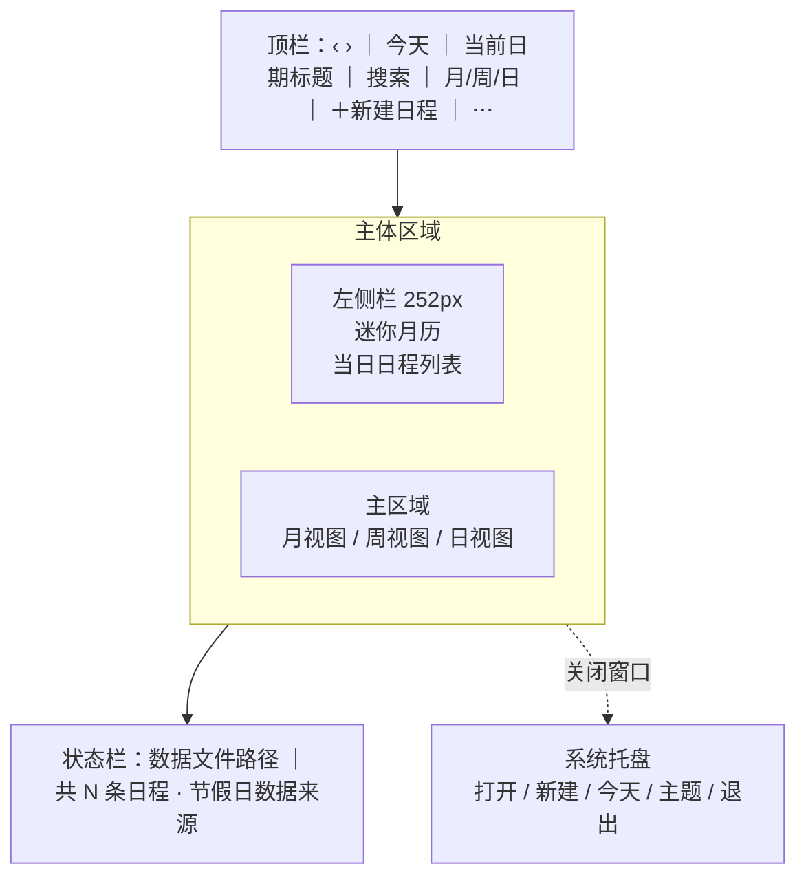

# 轻历 QingLi

一个**本地优先**的 Windows 日程与提醒应用：月 / 周 / 日三种视图、重复日程、到点提醒、ICS 导入导出、事件搜索、中国法定节假日与调休展示。

日程只保存在本机，不注册账号、不上传云端；只有节假日数据会在运行时从公开 CDN 拉取并缓存。

| 项目 | 内容 |
| --- | --- |
| 当前版本 | 1.2.0 |
| 系统要求 | Windows 7 SP1 及以上（Windows 10 / 11 体验最佳），.NET Framework 4.6+（Win10/11 已内置） |
| 安装包 | `QingLi-Setup-1.2.0.exe`（Inno Setup，中文向导，免管理员权限） |
| 安装位置 | `%LOCALAPPDATA%\Programs\QingLi` |
| 数据位置 | `%APPDATA%\QingLi\data.xml` |
| 开源协议 | [MIT](LICENSE) |

> 本文档对应 1.2.0。若你运行的是其他版本，功能以应用内 `⋯` →「关于轻历」为准。

---

## 30 秒上手

1. **安装**：双击 `QingLi-Setup-1.2.0.exe`。安装包未签名，SmartScreen 提示「未知发布者」时点「更多信息 → 仍要运行」；Windows 7 需先安装 .NET Framework 4.6。
2. **打开**：开始菜单 →「轻历」。首次启动是月视图，并定位到今天。
3. **新建**：在日历空白处双击，或按 `Ctrl+N`；填写标题和时间即可，其余字段都可留空。
4. **别丢提醒**：点窗口右上角关闭只会隐藏到系统托盘，提醒照常生效；要彻底退出请用托盘菜单 →「退出」。
5. **换外观**：`Ctrl+Shift+L` 循环切换「跟随系统 → 始终浅色 → 始终深色」。

### 我想……该怎么做

| 我想 | 操作 |
| --- | --- |
| 看一眼今天有什么 | 点顶栏「今天」或按 `T` |
| 快速新建 | 日历空白处双击；或 `Ctrl+N`；或右键 →「新建日程」 |
| 新建全天日程 | 月视图右键 →「新建全天日程」；或在编辑对话框勾选「全天」 |
| 找到很久以后的一件事 | `Ctrl+F`，输入标题 / 地点 / 备注 |
| 看下个假期是哪天 | 搜索 `holiday`、`vacation` 或 `节假日` |
| 把日程发给别人 | `⋯` →「导出全部日程为 ICS…」 |
| 从别的日历迁过来 | `⋯` →「导入 ICS 日历…」 |
| 改完颜色 / 主题立刻看效果 | 主题即点即生效；日程保存后立即重绘 |
| 让窗口消失但提醒继续 | 直接关闭窗口，应用留在托盘 |

---

## 界面一览



| 区域 | 作用 |
| --- | --- |
| 顶栏 | 翻页、回到今天、视图切换、搜索、新建、更多菜单 |
| 左侧迷你月历 | 快速跳日期、翻月、用圆点标记有日程的日期 |
| 左侧「当日日程」 | 查看选中日期当天的安排，点击条目直接编辑 |
| 主区域 | 月 / 周 / 日三种视图，支持双击新建、右键菜单、点事件编辑 |
| 状态栏 | 左边显示数据文件路径（切主题时临时显示提示），右边显示日程总数与节假日数据来源 |
| 系统托盘 | 关闭窗口后继续在后台运行；右键可新建、回到今天、切主题、退出 |

> 实际界面截图需在 Windows 交互式桌面截取，仓库未内置截图；可在本机运行 `tools\screenshot.ps1` 生成，见「测试与验证 → UI 验证」。

---

## 功能总览

| 场景 | 能力 |
| --- | --- |
| 看日历 | 月 / 周 / 日视图、前后翻页、回到今天、当前时刻线、迷你月历、当日日程侧栏 |
| 管日程 | 新建 / 编辑 / 删除、全天、跨天、地点、备注、8 色标记、右键菜单 |
| 重复 | 每天 / 每周 / 每月 / 工作日、重复截止日、「仅此一次」与「整个系列」 |
| 提醒 | 6 档提醒、托盘常驻、右下角气泡、5 分钟后提醒、点击气泡打开日程 |
| 搜索 | 标题 / 地点 / 备注、节假日中英文名、`calendar` 命令、结果键盘导航 |
| 节假日 | 自动拉取当年与次年、本地缓存、内置快照兜底、法定放假「休」与调休上班「班」 |
| 导入导出 | ICS（RFC 5545）导入与全量导出，导入自动跳过重复 |
| 外观 | 跟随系统 / 始终浅色 / 始终深色、跟随系统实时切换、8 色事件色板、DPI 缩放 |
| 后台 | 关闭到托盘、单实例运行、托盘菜单、退出时保存 |
| 数据 | 本地 XML、每次修改立即落盘、写入备份、损坏文件隔离、无云端同步 |

---

## 1. 看日历：月 / 周 / 日

### 月视图

- 固定 6 行 × 7 列，周一为一周第一天。
- 有日程的格子显示事件色块：全天事件只显示标题，定时事件显示 `HH:mm 标题`；格子放不下时显示「还有 N 项」。
- 今天用实心圆高亮，选中日期用强调色描边；周末、法定放假日、调休上班日分别使用不同文字颜色。
- 法定放假日显示「休」徽标，调休上班日显示「班」徽标；格子足够宽时还会显示节日名称。
- **双击**空白格新建日程（默认 09:00）；**单击**事件块打开编辑；**右键**空白格或事件块弹出菜单：新建日程 / 新建全天日程 / 编辑 / 删除。
- 跨天日程会在它覆盖的每一天都显示。

### 周视图 / 日视图

- 共用一套时间网格：左侧 24 小时刻度，每 30 分钟一条虚线，右上角有滚动条。
- 周视图显示 7 天（周一至周日），日视图只显示 1 天；两者都有当前时刻指示线与时间标签。
- 定时事件按时间位置绘制，时间重叠的日程自动并排分列；块高足够时显示标题和起止时间。
- 顶部有全天事件条，每个日期最多显示 2 条（更多全天事件不会出现在周 / 日视图，见「已知限制」）。
- **双击**空白时间段新建，时间按最近的 30 分钟对齐；**单击**事件块打开编辑；**右键**空白处或事件块弹出新建 / 编辑 / 删除菜单。
- **单击顶部日期表头**选中该日并同步左侧栏；日视图会直接跳转到该日。
- 滚动方式：鼠标滚轮、右侧滚动条、`PageUp` / `PageDown`，或让网格获得焦点后按 `↑` / `↓`。

### 导航

- 左上角 `‹` `›` 按当前视图翻页：月视图翻月、周视图翻 7 天、日视图翻 1 天。
- 「今天」按钮或 `T` 键回到今天。
- **启动时定位到今天**；切换视图会保留当前浏览的日期，不会强制跳回今天。
- 顶栏标题随视图变化：`2026年11月` / `2026年11月2日 - 8日` / `2026年11月7日 周六`。

### 迷你月历与当日日程

- 迷你月历可点 `‹` `›` 翻月；点击日期跳转主视图并刷新左侧列表。
- 有日程的日期下方有圆点；今天实心高亮，选中日期有圆环；法定放假日红字，调休上班的周末按工作日颜色显示。
- 左侧「日程 · M月d日 周X」列表显示选中日期的全部日程：颜色条、时间（全天显示「全天」）、标题、地点或结束时间。
- 列表可滚轮滚动；点击任意条目打开编辑；当天没有安排时显示「这一天没有安排 / 双击日历空白处即可新建」。
- 侧栏标题会追加当天的节假日信息，例如「日程 · 10月1日 周四 · 国庆节」或「· 调休上班」。

### 状态栏

- 左侧：`数据文件：C:\Users\<你>\AppData\Roaming\QingLi\data.xml`。切换主题后临时显示 2 秒「已切换到「…」」，然后恢复。
- 右侧：`共 N 条日程 · 节假日：已联网更新 11-07 09:30`（也可能是「本地缓存」或「内置数据」）。

---

## 2. 新建与编辑日程

### 入口

| 入口 | 行为 |
| --- | --- |
| 月视图双击空白格 | 在该日 09:00 新建 |
| 月视图右键 → 新建日程 | 在该日 09:00 新建 |
| 月视图右键 → 新建全天日程 | 在该日新建全天日程 |
| 周 / 日视图双击空白时间段 | 在点击的时间新建，按 30 分钟对齐 |
| 周 / 日视图右键 → 新建日程 | 在该日 09:00 新建 |
| 顶栏「＋ 新建日程」 | 在左侧选中的日期 09:00 新建 |
| `Ctrl+N` / 月视图 `Enter` | 在左侧选中的日期 09:00 新建 |
| 托盘菜单 →「新建日程」 | 以当前时间新建 |
| 搜索到日程后回车 / 点击 | 跳转到该日程并打开编辑 |

### 字段

| 字段 | 说明 |
| --- | --- |
| 标题 | 必填；为空时提示「请填写标题」 |
| 全天 | 勾选后隐藏时间下拉；结束日期**包含当天**（选 11/7–11/8 表示两天） |
| 开始 / 结束 | 可选择不同日期，支持跨天；结束必须晚于开始 |
| 重复 | 不重复 / 每天 / 每周 / 每月 / 工作日（周一至周五） |
| 提醒 | 不提醒 / 事件开始时 / 提前 5 / 15 / 30 分钟 / 提前 1 小时 / 提前 1 天 |
| 重复截止 | 仅重复日程可用；勾选后可选日期，提示「含截止日」；不勾选为「长期重复」 |
| 地点 | 显示在周 / 日视图事件块、侧栏和提醒气泡中 |
| 备注 | 多行文本；参与搜索，不显示在日历格中 |
| 颜色 | 8 个色点，用于月 / 周 / 日视图色块、侧栏色条和提醒气泡 |

补充细节：

- 时间下拉的小时是 `00`–`23`，分钟以 5 分钟为步长；编辑一条分钟数不是 5 的倍数的旧日程时，会保留原分钟值。
- 点击日期输入框会弹出迷你月历；屏幕下方空间不足时自动向上弹出。
- 新建日程默认选中「提前 15 分钟」提醒；可在对话框改为「不提醒」。
- 编辑已有日程时对话框左下角出现「删除」按钮；新建时不显示。
- `Ctrl+S` 保存，`Esc` 取消。
- 保存后立即写入 `data.xml`，日历即时刷新。

---

## 3. 重复日程

| 类型 | 规则 |
| --- | --- |
| 不重复 | 单次日程 |
| 每天 | 从开始日期起每天一次 |
| 每周 | 每周与开始日期同一个星期几 |
| 每月 | 每月与开始日期同一个「日」；遇到该月没有这一天时收敛到月末（31 号 → 2 月 28/29 日、4 月 30 日），不会逐月漂移 |
| 工作日 | 周一至周五，**只按星期几判断，不跳过法定节假日与调休** |

- **重复截止日**为闭区间：截止日当天的这次也会出现；不勾选则一直重复。
- 所有重复类型都保留开始时间的小时与分钟。
- 修改重复日程时会弹出范围选择：
  - **仅此一次**：把这一次改成一条独立日程，并在原系列中把这次标记为排除；
  - **整个系列**：修改主记录，所有未排除的发生一起变化；
  - **取消**：不保存。
- 删除重复日程时同样可选「仅此一次」或「整个系列」；删除单次会把该次加入排除列表，重启后仍然生效。
- 如果把重复类型改成「不重复」，原系列的排除列表会被清空。

---

## 4. 到点提醒

### 提醒档位

| 选项 | 实际含义 |
| --- | --- |
| 不提醒 | 不触发 |
| 事件开始时 | 开始时刻触发 |
| 提前 5 分钟 / 15 分钟 / 30 分钟 | 开始前对应分钟数触发 |
| 提前 1 小时 | 开始前 60 分钟 |
| 提前 1 天 | 开始前 1440 分钟 |

### 触发机制

- 应用每 **20 秒**扫描一次（范围约为过去 3 小时到未来 27 小时）的日程。
- 当「开始时间 − 提醒提前量」落在当前时间之前 15 分钟内时触发。
- 同一次发生在一个应用会话内只提醒一次（按「日程 Id + 开始时间」去重）。
- 应用未运行期间错过的提醒不会补发。
- 「稍后提醒」只保存在内存里，退出应用后失效。

### 气泡行为

- 在屏幕右下角弹出，不抢焦点，不打断正在输入的内容；多个提醒会向上堆叠。
- 停留 **25 秒**后自动关闭，弹出时播放一次系统提示音。
- 显示标题、日期时间、地点和「日程提醒」标签，左侧色条与日程颜色一致。
- 按钮：
  - **5 分钟后提醒**：5 分钟后再弹一次；
  - **知道了**：关闭；
  - **点击气泡其他区域**：恢复主窗口并跳转到该日程所在日期。
- 已打开的气泡会跟随深浅主题切换重绘。

> 提醒依赖应用在运行。关闭窗口只是隐藏到托盘，提醒照常生效；从托盘「退出」后不再提醒。本应用使用自绘气泡，不进入 Windows 通知中心，也不受「专注助手」拦截。

---

## 5. 搜索

按 `Ctrl+F` 聚焦搜索框，边输入边显示结果，最多 8 条。

### 搜索范围

- **日程**：匹配标题、地点、备注（不区分大小写）。重复日程按主记录匹配，副标题显示首次开始时间、重复规则和地点；结果按与当前时间的距离排序。
- **节假日**：匹配节日中文名与内置英文别名。同名节日优先返回放假日；优先未来两年内，没有未来记录时回看过去一年。
- **命令**：`calendar`、`calander`、`cal` 会置顶一条「回到今天（Calendar）」。

### 节假日英文别名

| 节日 | 可用关键词（示例） |
| --- | --- |
| 元旦 | `new year` |
| 春节 | `spring festival`、`chinese new year`、`cny` |
| 清明节 | `qingming`、`tomb sweeping` |
| 劳动节 | `labour day`、`labor day`、`may day` |
| 端午节 | `dragon boat` |
| 中秋节 | `mid autumn`、`moon festival` |
| 国庆节 | `national day` |

### 通配关键词

输入 `holiday`、`vacation`、`节假`、`节假日`、`假期` 会列出最近 **3 个**即将到来的节假日。

### 键盘操作

| 按键 | 功能 |
| --- | --- |
| `↑` / `↓` | 在结果中移动 |
| `Enter` | 打开当前结果：日程跳转并编辑，节假日跳转日期，`calendar` 回到今天 |
| `Esc` | 清空搜索并关闭结果浮层 |

---

## 6. 中国法定节假日与调休

### 数据来源与兜底

启动时在后台拉取**当年与次年**数据，按顺序尝试三个公开地址（每个 8 秒超时）：

1. `cdn.jsdelivr.net` 上的 holiday-cn 数据
2. `fastly.jsdelivr.net` 备用节点
3. `raw.githubusercontent.com` 源站

数据来自 [holiday-cn](https://github.com/NateScarlet/holiday-cn)（依据国务院办公厅节假日安排公告整理）。

加载顺序与优先级：**内置快照 → 本地缓存 → 联网数据**，后者覆盖前者：

- 内置快照编译在 `src/HolidayData.cs`，断网时保证有数据；
- 本地缓存位于 `%APPDATA%\QingLi\holidays-{year}.json`，按年累积，不会自动清理；
- 联网成功后写回对应年份的缓存文件；
- 三个地址都失败时继续使用缓存或内置数据，不影响其他功能。

状态栏右侧显示当前来源：`内置数据` / `本地缓存` / `已联网更新 M-d HH:mm`。

### 展示位置

| 位置 | 表现 |
| --- | --- |
| 月视图 | 法定放假日显示「休」徽标，调休上班日显示「班」徽标；空间足够时显示节日名；放假日红字，调休上班的周末按工作日颜色 |
| 周 / 日视图表头 | 放假日显示节日名，调休上班显示「班」；放假日红字 |
| 迷你月历 | 放假日红字，调休上班的周末按工作日颜色；**不显示「休 / 班」徽标** |
| 左侧「日程」标题 | 追加节日名或「调休上班」 |
| 状态栏 | 显示数据来源与更新时间 |
| 搜索 | 支持中文名、英文别名与通配关键词 |

### 注意

- 次年安排通常在当年 11–12 月公布；公布前应用内次年节假日为空，联网成功后自动补全。
- 只覆盖中国法定节假日与调休，不包含农历日期、二十四节气、自定义纪念日或公司假日。

---

## 7. ICS 导入导出

入口都在顶栏 `⋯` 菜单。

### 导出

- **导出全部日程为 ICS…**：导出整个日程库，不是当前视图或当前月份。
- 默认文件名 `轻历-YYYYMMDD.ics`，UTF-8 无 BOM。
- 写入 `VCALENDAR` 2.0，每条日程包含：
  - `UID`、`DTSTAMP`；
  - `DTSTART` / `DTEND`：全天事件用 `VALUE=DATE`（结束日期为次日，符合 RFC 的排他语义），定时事件用 UTC `Z` 时间；
  - `SUMMARY`、`LOCATION`、`DESCRIPTION`（逗号、分号、反斜杠、换行按 RFC 转义）；
  - 有提醒时写 `VALARM`（`ACTION:DISPLAY` + 负的 `TRIGGER`）；
  - 重复日程写 `RRULE`：每天 `DAILY`、每周 `WEEKLY;BYDAY=<开始星期>`、每月 `MONTHLY`、工作日 `WEEKLY;BYDAY=MO,TU,WE,TH,FR`，有截止日时带 `UNTIL`。
- 导出成功后会弹出「已导出 N 条日程到：…」。

### 导入

- **导入 ICS 日历…**：选择 `.ics` 文件后逐条读取。
- 支持：
  - `VEVENT` 中的 `SUMMARY` / `LOCATION` / `DESCRIPTION`；
  - `DTSTART` / `DTEND` / `DURATION`，全天事件（`VALUE=DATE`）；
  - `VALARM` 的负偏移 `TRIGGER`（转为提醒提前分钟数）；
  - `RRULE` 的 `FREQ=DAILY / WEEKLY / MONTHLY`、`BYDAY`、`UNTIL`、`COUNT`；
  - 折行的 ICS 行（以空格或 Tab 开头的续行）。
- 去重规则：标题相同且开始时间完全相同的日程会跳过；其余全部新增，不做覆盖或合并。
- 导入完成提示：`读取 N 个事件，新增 M 条（重复已跳过）。`
- 导入的事件会重新生成内部 Id，不会与已有日程冲突。

---

## 8. 外观与主题

### 三档主题

| 档位 | 行为 |
| --- | --- |
| 跟随系统 | 读取 Windows 的「应用模式」；系统切深浅色后自动跟随 |
| 始终浅色 | 白底深字 |
| 始终深色 | 沿用 1.1.0 的 Win11 Dark 外观 |

入口有三处，状态互相同步：

- 顶栏 `⋯` →「主题」；
- 托盘右键 →「主题」；
- 快捷键 `Ctrl+Shift+L`，循环顺序：跟随系统 → 始终浅色 → 始终深色 → 跟随系统。

### 默认值与持久化

- 全新安装（没有 `data.xml`）：跟随系统。
- 从 1.1.0 升级（有 `data.xml` 但没有 `<Theme>`）：始终深色，保持旧外观。
- 显式保存过主题：按保存值；空值或非法值回退「跟随系统」。
- 主题写入 `data.xml` 的 `<Settings><Theme>`，取值为 `system` / `light` / `dark`；选中即写盘，不重启、不重载日程。

### 切换效果

- 主窗口、月 / 周 / 日视图、侧栏、搜索浮层、右键菜单、托盘菜单、编辑对话框、范围选择框、提醒气泡同步换色。
- 已打开的编辑对话框和提醒气泡也会立即更新，输入内容不丢失。
- 状态栏左侧临时提示「已切换到「…」」2 秒。
- 标题栏通过 DWM 沉浸式属性在深 / 浅两套之间双向切换；Win7 或关闭 DWM 时标题栏保持系统浅色。
- 系统 `MessageBox`（删除确认、关于）由 Windows 绘制，不随应用主题变化。

### 配色

- 深浅两套完整调色板，覆盖窗口、卡片、边框、三级文字、强调色、危险色、今天高亮、周末、节假日、调休徽标、现在时刻线。
- 8 色事件色板索引固定为 0–7，已写入 `data.xml`；深浅主题下具体色值不同，但索引与日程的对应关系不变。
- 两套配色的正文、次要、弱化文字均按 WCAG 2.1 AA（≥ 4.5:1）校验；选中日期格另有 2px 强调色描边。
- 字体优先使用「Microsoft YaHei UI / Microsoft YaHei / Segoe UI / Tahoma」，缺失时回退 Segoe UI。

---

## 9. 托盘、单实例与后台运行

- 点击窗口关闭按钮（或 `Alt+F4`）默认**隐藏到系统托盘**，不退出；首次隐藏时弹一次气泡「轻历仍在后台运行」。
- 双击托盘图标恢复窗口；托盘右键菜单：
  - 打开轻历；
  - 新建日程（以当前时间打开编辑框）；
  - 今天；
  - 主题（三档子菜单，带勾选）；
  - 退出（真正退出并保存数据）。
- 提醒服务在托盘状态下继续运行。
- **单实例**：重复启动时不会开第二个窗口，而是把已运行的窗口恢复并置前。
- 退出时会保存 `data.xml`；正常关机 / 注销也会走保存流程。
- 顶栏 `⋯` 菜单除导入导出与主题外，还提供：
  - **打开数据文件夹**：用资源管理器打开 `%APPDATA%\QingLi`；
  - **关于轻历**：查看版本、功能简介与数据目录。

---

## 快捷键

### 主窗口

| 按键 | 功能 |
| --- | --- |
| `Ctrl+N` | 新建日程（选中日期 09:00） |
| `Ctrl+F` | 聚焦搜索框并全选 |
| `Ctrl+1` / `Ctrl+2` / `Ctrl+3` | 月 / 周 / 日视图 |
| `Ctrl+Shift+L` | 循环切换主题 |
| `T` | 回到今天 |
| `←` / `→` / `↑` / `↓` | 月视图移动选中日期（跨月自动翻页） |
| `Enter` | 月视图在选中日期新建日程 |
| `Esc` | 关闭搜索浮层 |

### 搜索框

| 按键 | 功能 |
| --- | --- |
| `↑` / `↓` | 移动选中结果 |
| `Enter` | 打开当前结果 |
| `Esc` | 清空并关闭 |

### 周 / 日视图

| 按键 | 功能 |
| --- | --- |
| 鼠标滚轮 | 上下滚动时间网格（鼠标位于网格上即可） |
| `PageUp` / `PageDown` | 网格获得焦点时按视口高度滚动 |
| `↑` / `↓` | 网格获得焦点时滚动 |

### 编辑对话框

| 按键 | 功能 |
| --- | --- |
| `Ctrl+S` | 保存 |
| `Esc` | 取消并关闭 |

---

## 数据、缓存与隐私

### 文件位置

| 文件 | 内容 |
| --- | --- |
| `%APPDATA%\QingLi\data.xml` | 全部日程与设置 |
| `%APPDATA%\QingLi\data.xml.bak` | 上一次保存的备份（存在时） |
| `%APPDATA%\QingLi\data.xml.corrupt-yyyyMMddHHmmss` | 加载失败时隔离出来的损坏文件 |
| `%APPDATA%\QingLi\holidays-{year}.json` | 按年缓存的节假日数据，可安全删除（下次联网重新拉取） |
| `%TEMP%\QingLi-crash.log` | 启动或未处理异常时的崩溃日志，追加写入 |

### 写入与损坏恢复

- 每次新增 / 修改 / 删除都会立即落盘：先写 `data.xml.tmp`，再替换正式文件，并保留一份 `.bak`。
- 如果 `data.xml` 不是合法 XML，应用会把原文件复制为 `data.xml.corrupt-<时间戳>`，然后以空数据启动；**不会自动从 `.bak` 恢复**，需要手动把备份改回 `data.xml`。
- 磁盘写入失败（磁盘满、权限异常等）不会弹窗，只在 Debug 输出中记录；重要数据请定期备份整个 `%APPDATA%\QingLi`。
- 换电脑：退出应用后复制 `%APPDATA%\QingLi`（至少 `data.xml`）到新机器同一位置，再启动即可。

### 隐私

- 日程数据不上传任何服务器，没有账号、遥测或云同步。
- 唯一的网络请求是启动时拉取节假日 JSON（三个公开 CDN / GitHub 地址），失败不影响其他功能。
- 卸载时可选择是否删除 `%APPDATA%\QingLi`。

<details>
<summary>data.xml 字段说明（开发者 / 排障用）</summary>

`<QingLiData>` 根节点下：

| 字段 | 类型 | 说明 |
| --- | --- | --- |
| `Version` | int | 数据格式版本，当前为 1 |
| `Settings.View` | int | 上次使用的视图：0 月 / 1 周 / 2 日 |
| `Settings.Theme` | string | `system` / `light` / `dark`；空串表示未设置 |
| `Settings.DefaultReminderMinutes` | int | 新建日程的内部默认提醒分钟数，当前 10，界面按最近档位显示为「提前 15 分钟」 |
| `Settings.CloseToTray` | bool | 关闭按钮是否隐藏到托盘，默认 true |
| `Settings.MinimizeToTray` | bool | 内部保留字段，当前未使用 |
| `Settings.LastExportPath` | string | 记录上次导出路径，当前不参与功能 |
| `Events` | list | 日程主记录列表，重复日程只存一条 |

每条 `EventItem`：

| 字段 | 类型 | 说明 |
| --- | --- | --- |
| `Id` | string | GUID（无连字符），导入时会重新生成 |
| `Title` | string | 标题 |
| `Start` / `End` | DateTime | 本地时间；全天日程的 `End` 为最后一天 23:59:59 |
| `AllDay` | bool | 是否全天 |
| `Location` / `Notes` | string | 地点 / 备注 |
| `ReminderMinutes` | int | -1 不提醒；0 开始时；其余为提前分钟数 |
| `Recurrence` | enum | 0 不重复 / 1 每天 / 2 每周 / 3 每月 / 4 工作日 |
| `RecurrenceUntil` | DateTime | `DateTime.MinValue` 表示无截止日；否则为含截止日 |
| `ExcludedStarts` | list | 被单独删除或改单次的重复实例原始开始时间 |
| `ColorIndex` | int | 0–7，对应 8 色事件色板 |

> 手动编辑前请先退出应用并备份文件；应用运行时会覆盖你的修改。

</details>

---

## 安装、升级与卸载

### 安装

- 运行 `QingLi-Setup-1.2.0.exe`，中文向导，**免管理员权限**，安装到 `%LOCALAPPDATA%\Programs\QingLi`。
- 安装时可选「创建桌面快捷方式」，默认不勾选；开始菜单会创建「轻历」和「卸载 轻历」。
- 安装目录内附带 `README.txt`（纯文本速查），安装完成后可直接启动。
- 安装 / 升级时若轻历正在运行，安装器会提示关闭（`AppMutex` + `CloseApplications`）。
- 安装包未签名，首次运行可能出现 SmartScreen「未知发布者」；点「更多信息 → 仍要运行」。

### 升级

- 直接运行新版本安装包覆盖安装即可，`%APPDATA%\QingLi` 中的日程与缓存会保留。
- 1.1.0 → 1.2.0 的主题默认值处理见「默认值与持久化」；若退回 1.1.0 使用，旧版保存时会丢弃 `<Theme>`，再回到 1.2.0 会重新按「升级」处理为深色。

### 卸载

- 设置 → 应用 →「轻历」→ 卸载，或开始菜单 →「卸载 轻历」。
- 卸载结束时会询问是否同时删除本机的日程数据；选「否」即保留，升级 / 重装后可继续使用。
- 卸载会删除安装目录；选择删除数据时同时清理 `%APPDATA%\QingLi`（日程与节假日缓存）。

> **静默卸载会无提示删除数据**：使用 `/VERYSILENT` 或 `/SILENT` 时不会弹询问框，`%APPDATA%\QingLi` 会被直接删除。脚本化卸载前请先备份该目录；日常卸载请走交互式向导并在弹窗里选「否」。

---

## 构建

### 依赖

不引入任何第三方 NuGet 包或 DLL，只依赖系统自带工具和 Inno Setup：

| 依赖 | 说明 |
| --- | --- |
| .NET Framework C# 编译器 | Windows 自带 `C:\Windows\Microsoft.NET\Framework64\v4.0.30319\csc.exe`（32 位系统回退 `Framework`）；源码按 **C# 5** 语法编写 |
| Inno Setup 6 | `ISCC.exe`，默认查找 `%LOCALAPPDATA%\Programs\Inno Setup 6\`，其次 `C:\Program Files (x86)\Inno Setup 6\`；可用 `winget install JRSoftware.InnoSetup` 安装 |
| PowerShell | Windows PowerShell 5.1+，用于构建脚本与图标生成（System.Drawing） |

### 一键构建

```powershell
powershell -ExecutionPolicy Bypass -File build.ps1
# [1/3] 生成多尺寸 app.ico（16/24/32/48/64/128/256）
# [2/3] csc 编译 src\*.cs -> build\QingLi.exe
# [3/3] ISCC 打包 installer.iss -> dist\QingLi-Setup-1.2.0.exe
```

产物：

- `build\QingLi.exe`：带图标与 DPI manifest 的绿色可执行文件；
- `dist\QingLi-Setup-1.2.0.exe`：中文安装包。

### 发布新版本时

1. 修改 `src\AssemblyInfo.cs` 的 `AssemblyVersion` / `AssemblyFileVersion`；
2. 修改 `installer.iss` 的 `AppVersion`（两者必须一致，`tools\verify.ps1` 会检查）；
3. 同步 README / README.txt 中的版本号与安装包名；
4. 更新 `.github/workflows/release.yml` 里硬编码的 Release 说明；
5. 运行 `tools\verify.ps1`，再打 `v*` tag 触发发布。

---

## 测试与验证

### 自动化测试

三套测试都是独立控制台程序，退出码 0 表示全部通过。

| 套件 | 断言数 | 覆盖 |
| --- | --- | --- |
| `tests/TestCore.cs` | 22 | 持久化往返、每天 / 每周 / 每月（月末收敛）/ 工作日重复展开、区间裁剪、单次删除排除项、ICS 导入导出往返 |
| `tests/TestHoliday.cs` | 36 | JsonLite 解析、数据源与内置快照两种形态合并、缓存与损坏回退、`calendar` / `calander` 关键词、中英文节假日搜索、去重与范围限制 |
| `tests/TestTheme.cs` | 127 | 三档解析与非法值回退、全新安装 / 升级默认值、深浅调色板取值、WCAG 2.1 AA 对比度、事件 8 色映射、`<Theme>` 写入读回、损坏文件备份回退、主题变更广播 |

单独运行：

```powershell
$csc = "C:\Windows\Microsoft.NET\Framework64\v4.0.30319\csc.exe"
$flags = "/nologo /langversion:5 /codepage:65001"

# 数据层
& $csc $flags.Split() /target:exe /out:build\TestCore.exe tests\TestCore.cs src\Models.cs src\Ics.cs
build\TestCore.exe

# 节假日与搜索
& $csc $flags.Split() /target:exe /out:build\TestHoliday.exe tests\TestHoliday.cs src\HolidayService.cs src\HolidayData.cs src\JsonLite.cs
build\TestHoliday.exe

# 主题
& $csc $flags.Split() /target:exe /out:build\TestTheme.exe tests\TestTheme.cs src\Theme.cs src\Models.cs src\Ics.cs `
  /reference:System.Drawing.dll /reference:System.Windows.Forms.dll /reference:System.Xml.dll
build\TestTheme.exe
```

### 一键回归

```powershell
powershell -ExecutionPolicy Bypass -File tools\verify.ps1
```

覆盖：

1. 用系统 `csc` 编译整个应用（无第三方依赖）；
2. 编译并运行三套测试；
3. 主题静态约束：`Theme.cs` 之外不允许出现颜色字面量或裸十六进制色值；
4. 主题实现约束：三档枚举、注册表读取、DWM 标题栏、系统广播去抖、菜单勾选、`Theme.Changed` 订阅释放等；
5. 版本号一致性：`AssemblyInfo.cs` 与 `installer.iss`。

最后输出 `结果: N 通过, M 失败`，失败时退出码非 0。

> 仓库目前只在推送 `v*` tag 时运行 CI（构建 + 测试 + 发布），普通 PR 不会自动跑测试；提交前请在本地执行 `tools\verify.ps1`。

### UI 验证

自绘控件没有 UIAutomation 句柄，UI 层验证使用「屏幕坐标驱动 + 截图」：

- `tools\stage-*.ps1`：按阶段驱动新建、编辑、删除、重复、提醒、搜索、ICS 导入导出、节假日徽标与英文搜索；
- `tools\uilib.ps1`：窗口定位、点击、输入、截图等公共函数；
- `tools\screenshot.ps1`：截取指定窗口或全屏：

```powershell
# 先启动轻历，再截主窗口
powershell -ExecutionPolicy Bypass -File tools\screenshot.ps1 -Title "轻历" -Out shot.png

# 截全屏
powershell -ExecutionPolicy Bypass -File tools\screenshot.ps1 -FullScreen -Out screen.png
```

注意：

- UI 脚本需要**未锁定的交互式 Windows 桌面**，远程 / 无桌面会话中无法驱动；
- 坐标按 1240×790 客户区、100% 缩放编写，改窗口大小或 DPI 后需要调整；
- `stage-a` 到 `stage-f` 以仓库目录名 `qingli` 为前缀（`.\qingli\tools\uilib.ps1`），请把仓库检出为 `qingli` 或自行调整路径；`stage-h` 已改用 `$PSScriptRoot`。

---

## 发布

推送语义化 tag 即可自动发布：

```bash
git tag v1.2.0
git push origin v1.2.0
```

`.github/workflows/release.yml` 在 `windows-latest` 上：

1. 安装 Inno Setup 6；
2. 运行 `build.ps1`（图标 + csc + ISCC）；
3. 编译并运行三套测试，任一失败则终止；
4. 计算安装包 SHA256；
5. 用 `gh release create` 创建 Release（已存在则替换资产并更新说明），附安装包与 SHA256。

发布前请确认 tag 与 `AssemblyVersion` / `AppVersion` 一致；Release 说明目前硬编码在 workflow 中，发新版时需要同步修改。

---

## 仓库结构

```text
.
├── src/                      # 应用源码（C# 5，目标 .NET Framework 4.x）
│   ├── Program.cs            # 入口、单实例、DPI、崩溃日志
│   ├── MainForm.cs           # 主窗口：布局、命令、搜索、托盘、导入导出
│   ├── MonthView.cs          # 月视图（事件色块、节假日 / 调休徽标）
│   ├── TimeGridView.cs       # 周 / 日视图（时间网格、全天条、现在线）
│   ├── EventDialog.cs        # 新建 / 编辑日程对话框、颜色选择
│   ├── Controls.cs           # 自绘控件（按钮、分段、迷你月历、日期框、下拉、复选框）
│   ├── Models.cs             # 数据模型、持久化、重复展开
│   ├── HolidayService.cs     # 节假日拉取、缓存、搜索（多源回退）
│   ├── HolidayData.cs        # 构建期嵌入的节假日快照（断网兜底）
│   ├── JsonLite.cs           # 极简 JSON 解析器
│   ├── Ics.cs                # ICS（RFC 5545）导入导出
│   ├── Reminder.cs           # 提醒调度 + 右下角气泡
│   ├── Theme.cs              # 深浅调色板、语义令牌、主题档位、系统主题、标题栏
│   ├── AssemblyInfo.cs       # 程序集版本号（与 installer.iss 同步）
│   └── app.manifest          # DPI / 兼容性声明
├── tests/
│   ├── TestCore.cs           # 数据层 22 项断言
│   ├── TestHoliday.cs        # 节假日 / JSON / 搜索 36 项断言
│   └── TestTheme.cs          # 主题 / 对比度 / 持久化 127 项断言
├── tools/                    # 构建与 UI 实测辅助脚本
│   ├── verify.ps1            # 一键回归（编译 + 测试 + 静态约束 + 版本一致性）
│   ├── screenshot.ps1        # 窗口 / 全屏截图
│   ├── uilib.ps1             # UI 自动化公共函数
│   └── stage-a…h.ps1         # 分阶段 UI 验证脚本
├── docs/
│   └── theme-modes.md        # 主题模式产品设计文档（决策、配色、验收）
├── .github/workflows/
│   └── release.yml           # tag 触发的构建 / 测试 / Release 流程
├── installer.iss             # Inno Setup 安装脚本
├── zh-CN.isl                 # Inno Setup 中文消息表
├── build.ps1                 # 一键构建：图标 → csc → ISCC
├── README.md                 # 本文件（GitHub）
├── README.txt                # 安装包内附带的纯文本速查
├── LICENSE
└── .gitignore
```

### 想改什么，看哪里

| 需求 | 主要文件 |
| --- | --- |
| 主窗口布局、菜单、搜索、托盘、导入导出 | `src/MainForm.cs` |
| 月视图绘制与交互 | `src/MonthView.cs` |
| 周 / 日视图时间网格 | `src/TimeGridView.cs` |
| 新建 / 编辑对话框、字段校验 | `src/EventDialog.cs` |
| 数据模型、保存、重复展开 | `src/Models.cs` |
| ICS 读写规则 | `src/Ics.cs` |
| 提醒触发与气泡 | `src/Reminder.cs` |
| 节假日拉取 / 缓存 / 搜索 | `src/HolidayService.cs`、`src/HolidayData.cs` |
| 颜色、字体、主题、标题栏 | `src/Theme.cs` |
| 自绘按钮 / 输入框 / 日期框 | `src/Controls.cs` |
| 启动、单实例、崩溃日志 | `src/Program.cs` |
| 安装包行为、卸载提醒 | `installer.iss`、`zh-CN.isl` |

---

## 已知限制

1. **重复日程的单次修改**：「仅此一次」编辑会生成一条独立日程，并把原系列的那一次标记为排除；排除项无法在界面上恢复。从搜索结果打开重复日程时，会直接编辑整个系列，不弹范围选择。
2. **工作日重复不感知节假日**：只按周一至周五判断，国庆、春节等法定假日所在的工作日仍会生成日程；调休上班的周末也不会自动补上。
3. **ICS 重复规则不完整**：每周重复按事件开始日期所在的星期展开，`BYDAY` 的具体星期不解析；`MO,WE,FR` 之类的多天组合会被当成单个星期；`INTERVAL`、`BYMONTHDAY`、`BYSETPOS` 等参数被忽略；`COUNT` 只做近似换算。
4. **ICS 时区**：带 `Z` 的按 UTC 转本地；带 `TZID` 的忽略时区名、按本地时间处理。导入按 UTF-8 读取，非 UTF-8 文件可能乱码。
5. **ICS 导出不折行、不含排除项**：长标题 / 备注不会按 RFC 5545 折行，部分客户端可能显示异常；单次删除的重复实例不会写成 `EXDATE`，在别的日历里会重新出现。
6. **提醒依赖应用运行**：未运行期间错过的提醒不会补发；「5 分钟后提醒」只存在内存，退出后失效；气泡不进入 Windows 通知中心。
7. **周 / 日视图全天事件最多 2 条**：每个日期只显示前 2 条全天事件，超出部分不显示；月视图会显示「还有 N 项」。
8. **无农历与自定义节假日**：不显示农历日期、节气、纪念日，也不支持自定义假日 / 公司假日，只展示中国法定节假日与调休。
9. **单一日历**：没有多日历、分类、共享、账号或云同步；所有日程在同一个列表里，用 8 种颜色区分。
10. **搜索范围有限**：只搜标题 / 地点 / 备注；重复日程按主记录匹配；最多显示 8 条结果。
11. **写入失败无提示**：磁盘满或权限异常导致保存失败时，只在 Debug 输出记录，界面不会提示；请定期备份 `%APPDATA%\QingLi`。
12. **损坏文件不自动恢复**：`data.xml` 解析失败时会隔离为 `.corrupt-*` 并以空数据启动，不会自动读取 `.bak`。
13. **DPI**：按系统 DPI 缩放（system-aware），未做 Per-Monitor V2 的多显示器混合 DPI 自适应；125% / 150% 缩放未实测。
14. **安装包未签名**：首次运行可能弹 SmartScreen「未知发布者」；中文安装向导的少数边缘提示串（磁盘空间不足、文件占用等）回退英文。
15. **节假日次年数据**：依赖上游 holiday-cn 的年度发布节奏，通常当年 11–12 月公布；公布前次年节假日为空。
16. **主题边界**：Win7 或关闭 DWM 时深色标题栏仍为系统浅色；系统 `MessageBox`（删除确认、关于）不随主题变化；深色下多行备注框的滚动条仍是系统原生浅色。
17. **无开机自启**：未做开机自启或计划任务，需要手动启动（可把快捷方式放进「启动」文件夹）。
18. **PR 不跑 CI**：CI 只在推送 `v*` tag 时执行；普通 PR 的测试需要本地运行 `tools\verify.ps1`。

---

## 常见问题

**Q：日程数据在哪？换电脑怎么带走？**
`%APPDATA%\QingLi\data.xml`。退出应用后复制整个 `%APPDATA%\QingLi`（或至少 `data.xml`）到新机器同一路径即可。节假日缓存可以不带，联网后会重新拉取。

**Q：为什么提醒没有弹？**
确认应用仍在运行（托盘有图标）；确认该日程的「提醒」不是「不提醒」；确认「开始时间 − 提前量」已经到达且不超过 15 分钟。应用未运行期间错过的提醒不会补发。

**Q：为什么明年的假期是空的？**
次年的放假安排通常要到当年 11–12 月才由国务院公布。上游数据发布前无法显示；联网成功后会自动补全，也可以在状态栏确认数据来源。

**Q：为什么周末被标成「班」？**
那是调休上班日。应用按 holiday-cn 的数据把周末标为工作日颜色并显示「班」，法定放假日显示「休」。

**Q：深色主题下标题栏还是白的？**
Windows 7 或关闭了 DWM（桌面窗口管理器）时无法切换标题栏颜色，属于系统限制；客户区仍会正常显示深色。

**Q：卸载会删除我的日程吗？**
交互式卸载会询问，选「否」保留 `%APPDATA%\QingLi`；静默卸载（`/SILENT`、`/VERYSILENT`）会直接删除，脚本化卸载前请先备份。

**Q：能同步到手机或别的电脑吗？**
当前没有云同步。可以导出 ICS 后在手机或其他日历应用中导入；注意重复规则与提醒的兼容性限制。

**Q：为什么导出的 ICS 在别的日历里出现了我删掉的那一次？**
导出暂不写 `EXDATE`，单次排除项不会随文件带走；这是已知限制，见「已知限制」第 5 条。

---

## 参与贡献

- 源码保持 **C# 5** 语法，目标 .NET Framework 4.x，不引入 NuGet 或第三方 DLL。
- 视图层只使用 `Theme` 的语义颜色令牌，不要在 `Theme.cs` 之外写颜色字面量或裸十六进制色值（`verify.ps1` 会检查）。
- 提交前运行：

```powershell
powershell -ExecutionPolicy Bypass -File tools\verify.ps1
```

- 改动主题相关代码时，同步更新 `docs/theme-modes.md` 与 `tests/TestTheme.cs` 的断言。
- 安装包 / 版本号改动请同时更新 `src/AssemblyInfo.cs`、`installer.iss`、README 与 Release 说明。
- 普通 PR 不会自动跑 CI，请在 PR 描述中附上本地 `verify.ps1` 的结果。

---

## License

[MIT](LICENSE) © 2026 liunian0403
